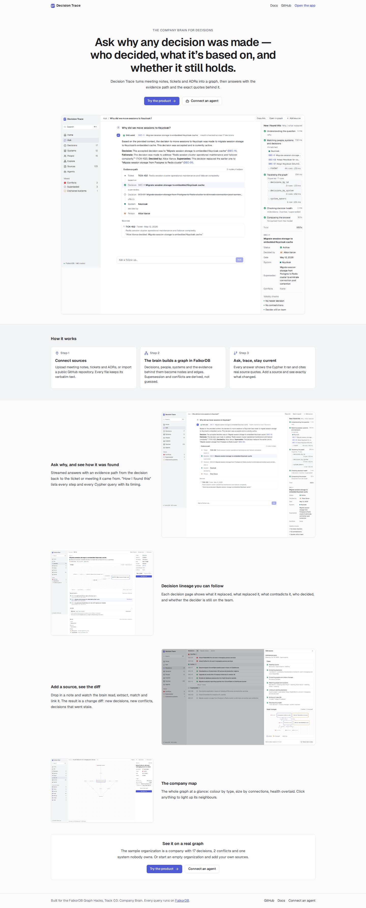
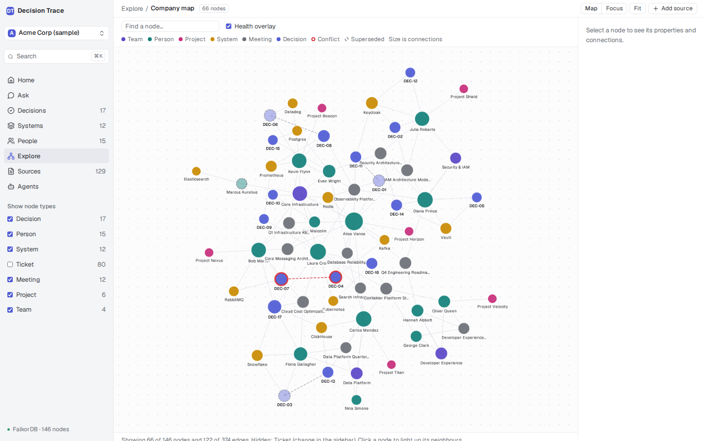
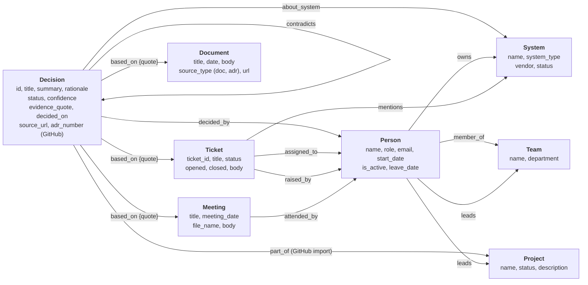
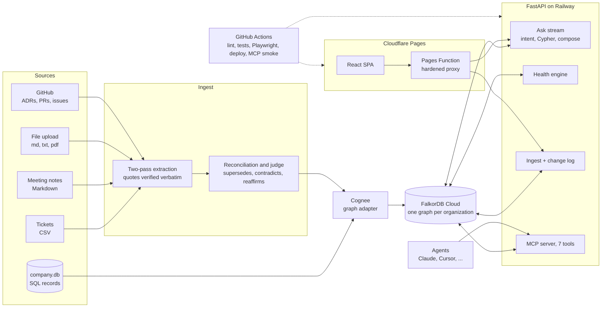

# Decision Trace

**Ask why any decision was made: who decided it, what it is based on, and whether it still holds.** A company brain that turns meeting notes, tickets, ADRs and org records into one FalkorDB graph and answers with the evidence path and the exact source quotes.

Built for the [FalkorDB Hackathon](https://www.falkordb.com/) (WeMakeDevs), Track 03: *Company Brain*, on FalkorDB Cloud and Cognee.

**Demo video: [link]**

| | |
| :-- | :-- |
| **Landing page** | https://decision-trace.pages.dev |
| **Live app** | https://decision-trace.pages.dev/app (Acme Corp sample; the Arachne real-repo organization is in the menu at the top of the sidebar) |
| **Connect an agent (MCP)** | https://decision-trace.pages.dev/app/agents · endpoint `https://decision-trace-api-production.up.railway.app/mcp` |
| **API health** | https://decision-trace-api-production.up.railway.app/health |


*Landing: the pitch, how it works, and the real-repo showcase.*


*Ask: the answer, its evidence path, and "How I found this" with every Cypher query.*


*Decision page: lineage, sources with quotes, health.*


*Company map: colour is type, size is connections, borders show health.*

## The problem, and the idea

Engineering knowledge is scattered across tickets, meeting notes and org records, and the *reasons* behind decisions are the first thing to rot. Months later someone asks **why** we moved sessions to Keycloak, **who** decided it and whether they are still here, **what** it was based on, and whether it is **still valid** or was superseded or contradicted.

Search finds documents; it does not tell you that two accepted decisions contradict each other, that a system's owner left in November, or what breaks if you drop Snowflake. Those are questions about *relationships*.

**Decision Trace** reads the sources, keeps decisions, people, systems and evidence in one FalkorDB graph (a verbatim quote on every link to its source), derives health from the graph itself, and answers from a Cypher-computed subgraph, showing the path and the queries it ran.

## Graph model

The schema below is read from the code and the frozen snapshot, not drawn from memory: labels and relationship names are exactly what the Cypher in `backend/app` and the ingest writers use (relationship types are lower-case in FalkorDB). Edges are directed as shown.



- **On the `based_on` edge:** every link from a decision to its source carries the **verbatim `quote`** that justifies it, checked against the source text when it is written.
- **Stored on nodes:** `Person.is_active` and `leave_date` (who has left), `Decision.status` (the lifecycle the extractor or the ADR stated: accepted, proposed, rejected, reverted, deprecated).
- **Computed, never stored:** *health* (`active`, `superseded`, `contradicted`, `possibly_stale`) comes from Cypher plus the rules in `brain/health.py` (a `supersedes` edge points at it, a `contradicts` edge touches it, a decider has left, or it is over 180 days old with nothing newer on its systems); `decision_code` (`DEC-01` ...) is numbered by date on read (`brain/codes.py`); a system is *orphaned* when a Person who `owns` it has left.
- **Bookkeeping:** items written by an ingest carry `demo_ingest_id` and `ingested_at` so a reset removes exactly them. Each organization is its own graph; a small `dt_registry` graph holds one `:Org` node per organization, and `<graph>__changes` holds the activity log (`:Change` nodes).
- **Counts in the Acme sample:** 146 nodes and 374 edges (17 Decision, 15 Person, 12 System, 4 Team, 6 Project, 80 Ticket, 12 Meeting). `Document` and `part_of` appear in organizations built from uploads and GitHub imports.

## How the agent queries the graph

Every answer is a short pipeline whose steps are shown in the app under *How I found this* (with each statement and its timing). Here is one question end to end, run against the live Acme graph.

**"Why did we move sessions to Keycloak?"**

1. **Intent (no model call).** Wording rules in `askflow/intent.py` classify it as `why` (impact, expertise and status have their own rules; only a question no rule matches gets one cheap model call to pick an intent).
2. **Entity match.** One Cypher statement lists every name the question could mean, and Python matches whole words against it, plus local embeddings (not an LLM) against decision titles:
   ```cypher
   MATCH (n) WHERE n:Person OR n:System OR n:Decision RETURN labels(n)[0], coalesce(n.name, n.title), n.id
   ```
   That returned 44 rows. `Keycloak` matches the **System**, and three **Decision** titles score above the threshold: DEC-11 (migrate session storage to embedded Keycloak cache), DEC-02 (adopt Keycloak for company-wide SSO) and DEC-12 (Keycloak OAuth2 tokens for the API gateway).
3. **Traversal.** Three statements run together (`askflow/queries.py`; shown here with line breaks added, the text is otherwise identical). The first takes the decision ids from step 2:
   ```cypher
   MATCH (d:Decision) WHERE d.id IN $decision_ids
   OPTIONAL MATCH (d)-[r_dec:decided_by]->(p:Person)
   OPTIONAL MATCH (d)-[r_sys:about_system]->(s:System)
   OPTIONAL MATCH (d)-[r_tic:based_on]->(t:Ticket)
   OPTIONAL MATCH (d)-[r_mtg:based_on]->(m:Meeting)
   OPTIONAL MATCH (d)-[r_doc:based_on]->(dc:Document)
   OPTIONAL MATCH (d)-[r_sup:supersedes]->(d_sup:Decision)
   OPTIONAL MATCH (d_sup_by:Decision)-[r_supby:supersedes]->(d)
   OPTIONAL MATCH (d)-[r_con:contradicts]-(d_con:Decision)
   OPTIONAL MATCH (s)<-[r_own:owns]-(owner:Person)
   RETURN d.id, d.title, coalesce(d.summary, ''), coalesce(d.rationale, ''), coalesce(d.status, 'accepted'),
          p.name, s.name, t.ticket_id, t.title, m.title, m.date, d_sup.id, d_sup.title,
          d_sup_by.id, d_sup_by.title, d_con.id, d_con.title,
          owner.name, coalesce(owner.is_active, true), coalesce(owner.leave_date, ''), dc.title, dc.date
   ```
   The second is the same `RETURN` and neighbours, starting from the system instead of the ids (`MATCH (d:Decision)-[r_sys:about_system]->(s:System) WHERE s.name IN $system_names ...`), and the third finds the owner:
   ```cypher
   MATCH (s:System) WHERE s.name IN $system_names
   OPTIONAL MATCH (s)<-[r:owns]-(p:Person)
   RETURN s.name, p.name, coalesce(p.is_active, true), coalesce(p.leave_date, '')
   ```
   **Rows returned (7).** DEC-11 `decided_by` Alice Vance, `about_system` Keycloak, `based_on` **TICK-102**, `supersedes` DEC-01 (*migrate session storage from Postgres to Redis cluster*); DEC-02 `decided_by` Julia Roberts, `based_on` the meeting *IAM Architecture Modernization*; DEC-12 `decided_by` Julia Roberts, `based_on` TICK-111; and Keycloak is `owns`-ed by Julia Roberts, who is active.
4. **Health check (cached Cypher).** The health map is the result of four whole-graph statements (decisions with their dates, `supersedes` pairs, `contradicts` pairs, deciders who left), recomputed after every ingest and cached for five minutes. Applied to these four decisions: *3 active, 1 superseded* (DEC-01, replaced by DEC-11).
5. **Evidence path.** Python assembles the nodes and edges that were returned into the `graph_path` the UI draws, and picks the primary decision (DEC-11) by scoring over the rows.
6. **Answer.** One model call receives only the rows above, as text, and is told to phrase them. The recorded answer:
   > **Decision:** The accepted decision was to "Migrate session storage to embedded Keycloak cache" (DEC-11).
   > **Rationale:** The decision was made to address "Redis session cluster operational maintenance and failover complexity" (TICK-102).
   > **Decided by:** Alice Vance.
   > **Supersedes:** This decision replaced the earlier one to "Migrate session storage from Postgres to Redis cluster" (DEC-01).
7. **Citations.** A source is cited only if a real `based_on` edge from the traversal points at it **and** the answer text names it (its id or title, or the DEC code of the decision it backs). TICK-102 passes; anything the model invented would be dropped.

**"What's affected if we drop Snowflake?"** Intent `impact` (rule match on *drop*). Three statements: `IMPACT_DECISIONS` follows `about_system` to the decisions on Snowflake and then `supersedes*1..5` in both directions, `IMPACT_PEOPLE` finds the owner, ticket participants and the teams and projects two hops away through `member_of`/`leads`, and `IMPACT_TICKETS` lists tickets that `mention` it. Rows: DEC-03 (*adopt Snowflake*, superseded by DEC-13), DEC-13 (*migrate reporting queries from Snowflake*), DEC-17 (*decommission Snowflake*), owner Fiona Gallagher, the Data Platform team, five tickets. Health marks DEC-03 superseded; the model only phrases the list.

**"Who knows the most about Kafka?"** Intent `expertise`. One statement (`EXPERTISE`) returns five evidence lists for the system: people who `decided_by` its decisions, who `owns` it, who `attended_by` a meeting that is a source of its decisions or mentions it, and who `raised_by`/`assigned_to` a ticket that `mentions` it. Python counts each list and weights it (decided x3, owns x3, meetings x2, tickets x1): Alice Vance 9 (decided DEC-04, owns Kafka, one meeting, one ticket), Bob Martin 7, Carlos Mendez 5, with the counts shown so the ranking can be checked.

## What comes from the graph vs the LLM

| Job | Done by | When |
| :-- | :-- | :-- |
| Reading a source and proposing decisions, deciders, systems and the verbatim quote | **LLM** (two passes; a quote that is not in the source text is dropped) | ingest |
| Whether a new decision supersedes, contradicts or reaffirms an existing one (prose sources) | **LLM** judge, then written as a `supersedes` / `contradicts` edge | ingest |
| ADR "Supersedes ADR-n" and status lines (GitHub import) | **Code** (text parsing), no model | ingest |
| Matching extracted names to existing people and systems; decision identity | **Rules + local embeddings** (reconciliation), no hosted LLM | ingest |
| Intent of a question | **Rules**; one cheap **LLM** call only when no rule matches | query |
| Matching a question to people, systems and decisions | **Cypher** roster + whole-word match + **local embeddings** on decision titles | query |
| Lineage (what replaced what, in both directions), conflicts | **Cypher** (`supersedes*1..5`, `contradicts`) | query |
| Health and staleness, departed deciders, orphaned systems | **Cypher** + rules in code | query |
| Impact of dropping a system | **Cypher** | query |
| Expertise ranking | **Cypher** evidence lists, counted and weighted in code | query |
| The evidence path (`graph_path`), the primary decision, the citations | **Cypher rows + code**; citations must be real `based_on` edges | query |
| Separate customers' data | **FalkorDB graphs**, one per organization | always |
| The wording of the final answer | **LLM**, from the rows only | query |

**The LLM never decides a relationship at query time.** At query time it receives only the rows Cypher returned and phrases them; every edge, status, owner, date and citation in an answer comes from the graph. Relationships that came from a model (a prose source's `supersedes` or `contradicts`) were written to the graph at ingest (live-ingest edges carry the judge's one-sentence `reason`) and are queryable and fixable like any other data. The model can still mis-phrase a result, so wording about status is corrected in code after generation and unsupported citations are dropped.

## Track 03 (Company Brain) mapping

| Focus area | What delivers it |
| :-- | :-- |
| **Docs, tickets and chats in one graph** | Tickets (CSV), meeting notes (Markdown), a company SQL database, **uploaded files** (.md, .txt, .pdf) and **GitHub repositories** (ADRs, decision PRs and issues) all land in **one FalkorDB graph per organization** (Acme: 146 nodes, 374 edges). The **Sources** page lists every document with the decisions it backs. Meeting notes are the conversational source; chat connectors are a next step. |
| **Who owns and who knows what** | `owns`, `member_of`, `leads` edges give ownership; **orphaned systems** flag owners who left; the `who_knows` ranking weighs decided (x3), owns (x3), meetings (x2) and tickets (x1) with the counts shown. People and Systems pages, and the **company map**. |
| **Tracing decisions back to their source** | Every decision has `based_on` edges to the ticket, meeting or document it came from, each with a **verbatim quote** checked against the source text at extraction time. The decision page and the Ask **evidence path** walk decision → source → people → systems. |
| **Keeping knowledge current** | **Live ingest** (paste, upload or import): two-pass extraction, entity matching and an LLM judge decide whether a new decision supersedes, contradicts or reaffirms an existing one. A **health engine** (superseded / contradicted / possibly stale) recomputes, and the **Needs attention** queue and change feed show what moved. ADR "Supersedes" lines become `supersedes` edges with no model call. |
| **Answers with sources** | `/ask` answers only from a graph subgraph computed by Cypher; citations must come from real `based_on` edges **and** be referenced in the answer. Each answer streams its steps, the Cypher it ran and its timings. The same tools are exposed to agents over **MCP**. |

## Try it in two minutes

1. **Sample question.** On [/app](https://decision-trace.pages.dev/app) click *Why did we move sessions to Keycloak?* The answer streams in with its evidence path and sources; open *How I found this* to see every step and Cypher query.
2. **Decision page.** Click the **DEC-11** chip: lineage (it superseded DEC-01), the source ticket and its quote, health, deciders.
3. **Add source, preset A then B.** *Add source* (top right) → **Arch sync: standardise on Kafka** → *Run*: a new decision, status changes and a resolved conflict between DEC-04 and DEC-07. Then **HR: Alice Vance leaves** → *Run*: her decisions become *possibly stale* and Kafka becomes an orphaned system. *Reset demo data* undoes it (it also resets itself after 10 idle minutes).
4. **Switch to real data.** Open the menu at the top of the sidebar → **Arachne (real GitHub ADRs)**: the ADR log of an open-source framework, imported from GitHub. Ask *"Why did we simplify the Chimera model?"* (it follows the ADR that superseded two earlier ones) or *"Which decisions were superseded?"*, then open **Explore** for the company map.
5. **Make your own.** Menu → *New organization*, then *Upload files* (drop in a `.md` or `.pdf`) or *GitHub* (try `https://github.com/npryce/adr-tools`). The result is a diff of what the brain learned; your organization is yours (see *Owner keys* below).
6. **Connect Claude via MCP.** Open [/app/agents](https://decision-trace.pages.dev/app/agents), copy the endpoint into Claude Code, Claude Desktop or Cursor, and ask *"Use Decision Trace to tell me what is affected if we drop Snowflake."* Every call shows in *Recent changes* on Home.

## Organizations, upload, GitHub import, company map

- **Organizations.** Every organization is its own FalkorDB graph (`org_<id>_<random>`). **Acme Corp** (the original graph) and **Arachne** (real ADRs) are *sample* organizations: shared, read-only apart from tagged demo ingests that reset themselves, never deleted. You can create your own from the menu: 40-character names, 25 in total, 3 creations per hour per IP, deleted after 72 idle hours. Every endpoint, the Ask stream, the caches and the MCP tools take an organization (`/orgs/<id>/...`, or the optional `org` argument on a tool).
- **Owner keys.** Creating an organization returns an `owner_key` once (stored server-side only as a hash, kept in your browser's localStorage). Adding sources, importing and deleting need it (`X-Org-Key`); *viewing* needs nothing, so anyone with a link can look. A browser without the key sees a clear read-only state. There is no sign-in: the key is the only credential.
- **File upload.** `.md`, `.txt` or `.pdf` (text extracted; scanned PDFs are skipped with a message), up to 10 files, 1 MB each, 50,000 characters in total. Each file gets a type (meeting, ticket, document or ADR, auto-detected unless you choose), long files are read in chunks by the same two-pass extractor, and the result is one combined diff.
- **GitHub import** (your own organizations). A public repository URL: ADR markdown from `docs/adr`, `doc/adr`, `docs/decisions`, `adr`, `architecture/decisions` or `ADR-*.md` (at most 40), plus, optionally, the last 30 closed PRs and issues that look like decisions. Status and "Supersedes ADR-n" lines become `supersedes` edges deterministically; authors become people; the repository becomes a Project. The model only names systems per ADR and judges PRs and issues, capped at 80,000 estimated tokens per import. Set `GITHUB_TOKEN` on the server for GitHub's 5,000/hour limit (without it: 60 requests per hour, and some dates are estimated, which the result says).
- **Company map.** Explore opens the whole graph: colour is node type, size is connections, Decision borders show health, tickets are hidden until you ask, search finds a node, clicking one lights up its neighbours. *Focus* narrows to one node's neighbourhood.

## Architecture



- **Backend**: FastAPI (Python 3.12) with per-IP rate limits, a daily LLM token budget, bounded queries and streaming (SSE) for Ask and ingest. A request to `/orgs/<id>/...` is rewritten to the plain route by a middleware that sets the organization's graph for that request (a context variable), so every query, cache and lock is per organization. Deployed to Railway from a lean multi-stage Dockerfile.
- **Graph**: FalkorDB Cloud holds everything structured. Decision-title similarity uses FastEmbed (`bge-small-en-v1.5`) computed locally (Cognee's vector store is a local LanceDB), which keeps the 100 MB free tier for the graph.
- **Frontend**: React, TypeScript, Vite, Tailwind, Cytoscape. Cloudflare Pages serves it and a Pages Function proxies `/api/*` to Railway with a path whitelist.
- **CI**: GitHub Actions lints, type-checks and unit-tests, runs about 90 Playwright tests with axe accessibility checks at 1440 and 390 px, deploys, then smoke-tests the live MCP endpoint with the official client.

## How FalkorDB is used

Everything the UI and the agents show is a Cypher query; Python only assembles rows. The Ask step list and the decision page both display the exact statements and their timings ("Show Cypher").

**Schema** (Acme: 146 nodes, 374 edges)

| Nodes | Count | Relationships | Count |
| :-- | --: | :-- | --: |
| `Decision` | 17 | `assigned_to`, `raised_by`, `mentions` (Ticket → Person/System) | 80 each |
| `Person` | 15 | `attended_by` (Meeting → Person) | 38 |
| `System` | 12 | `decided_by` (Decision → Person) | 19 |
| `Team` | 4 | `based_on` (Decision → Ticket/Meeting/Document, with a verbatim `quote`) | 18 |
| `Project` | 6 | `about_system` (Decision → System) | 18 |
| `Ticket` | 80 | `member_of`, `leads` (Person → Team/Project) | 15, 10 |
| `Meeting` | 12 | `owns` (Person → System) | 12 |
| `Document` | 0 (uploads, ADRs) | `supersedes`, `contradicts` (Decision ↔ Decision) | 3, 1 |
| | | `part_of` (Decision → Project, GitHub imports) | |

**Multi-tenant graphs.** Each organization is a separate FalkorDB graph; a small `dt_registry` graph lists them. Switching organization changes only the graph name a query runs on, so the same Cypher serves every tenant, deleting an organization is `GRAPH.DELETE`, and one organization's slow ingest never blocks another's. A 112-node, 156-edge import (the 40 ADRs of the Backstage repository) used about 1.1 MB of the instance.

**Real queries from the code**

*Lineage: walk the supersedes chain in both directions and find rivals* (`backend/app/brain/lineage.py`)
```cypher
MATCH (d:Decision) WHERE d.id = $id
OPTIONAL MATCH down = (d)-[:supersedes*1..5]->(older:Decision)
WITH d, collect(DISTINCT [older.id, length(down)]) AS supersedes
OPTIONAL MATCH up = (d)<-[:supersedes*1..5]-(newer:Decision)
WITH d, supersedes, collect(DISTINCT [newer.id, length(up)]) AS superseded_by
OPTIONAL MATCH (d)-[c:contradicts]-(rival:Decision)
RETURN properties(d), supersedes, superseded_by,
       collect(DISTINCT [rival.id, startNode(c).id = d.id]) AS conflicts
```

*Health: what replaced a decision, and who decided the replacement* (`backend/app/brain/health.py`)
```cypher
MATCH (d2:Decision)-[:supersedes]->(d:Decision)
OPTIONAL MATCH (d2)-[:based_on]->(t:Ticket)
OPTIONAL MATCH (d2)-[:based_on]->(m:Meeting)
RETURN d.id, d2.id, d2.title, t.ticket_id, m.title
```

*Impact: decisions on a system plus every decision in their supersedes chains* (`backend/app/askflow/queries.py`)
```cypher
MATCH (s:System)<-[:about_system]-(d:Decision) WHERE toLower(s.name) = toLower($name)
WITH collect(DISTINCT d) AS direct
UNWIND direct AS d
OPTIONAL MATCH (d)-[:supersedes*1..5]-(c:Decision)
WITH direct, collect(DISTINCT c) AS chained
UNWIND direct + chained AS x
WITH DISTINCT x
OPTIONAL MATCH (x)-[:decided_by]->(p:Person)
RETURN x.id, x.title, collect(DISTINCT p.name)
```

*Expertise: four kinds of evidence for one system, ranked in Python* (`backend/app/askflow/queries.py`)
```cypher
MATCH (s:System) WHERE toLower(s.name) = toLower($name)
OPTIONAL MATCH (s)<-[:about_system]-(d:Decision)-[:decided_by]->(p1:Person)
WITH s, collect(DISTINCT [p1.name, d.id]) AS decided
OPTIONAL MATCH (s)<-[:owns]-(p2:Person)
WITH s, decided, collect(DISTINCT p2.name) AS owns
OPTIONAL MATCH (s)<-[:about_system]-(:Decision)-[:based_on]->(:Meeting)-[:attended_by]->(p3:Person)
WITH s, decided, owns, collect(DISTINCT p3.name) AS meetings
OPTIONAL MATCH (s)<-[:mentions]-(t:Ticket)-[:raised_by|assigned_to]->(p5:Person)
RETURN decided, owns, meetings, collect(DISTINCT [p5.name, t.ticket_id])
```

*Orphaned systems: owned by someone who left* (`backend/app/brain/health.py`)
```cypher
MATCH (p:Person)-[:owns]->(s:System)
WHERE p.is_active = false
   OR (p.leave_date IS NOT NULL AND p.leave_date <> '' AND p.leave_date <= $today)
RETURN s.name, p.name, p.leave_date
```

**Why a graph.** "What is affected if we drop Snowflake?" is decisions *about* it, plus the decisions those superseded or were superseded by (variable-length paths), the people who decided them, who owns the system, which teams those people lead, and the tickets that mention it. "Do any decisions conflict?" is an edge between two accepted decisions. "Which systems have no owner?" is an `owns` edge to a person with a leave date. In SQL these are a stack of recursive joins; with vectors alone the relationship, the date and the person are lost. Here each is one readable statement that runs in about 100 to 400 ms on the free tier, and the answer can show its path.

## Evaluation

**Method.** `data/GROUND_TRUTH.md` lists the decisions, deciders, supersedes and contradicts relations in the main corpus. Two further sets of hand-written documents, `data/holdout/` (3 tickets, 3 meeting notes) and `data/holdout2/` (8 documents, 3 of them with no decision, to catch false positives), were written with their ground truth (`HOLDOUT_TRUTH.md`, `HOLDOUT2_TRUTH.md`) **before** the extractor was run on them. They avoid the "decided:" markers of the main data and bury decisions in discussion. Extraction is checked per decision against the truth by embedding similarity, and every extracted quote must appear verbatim in its source or the decision is dropped.

**Current numbers** (`bedrock/deepseek.v3.2`, temperature 0; re-run on 2026-10-18 after the Ask citation change, which does not touch extraction; the Acme graph did not change, so the snapshot was not re-frozen):

| Set | Truth | Extracted | Recall | Precision | Decider accuracy |
| :-- | --: | --: | --: | --: | --: |
| Main corpus (`scripts/evaluate.py`, live graph) | 16 | 17 | 100% (16/16) | 94.1% | 100% |
| Holdout 1 (cold extraction) | 6 | 5 | 83.3% (5/6) | 100% | 100% |
| Holdout 2 (cold extraction, 3 negative docs) | 5 | 4 | 80% (4/5) | 100% | 100% |

Relationships on the main corpus: `supersedes` 3/3 recall and precision, `contradicts` 1/1 recall and precision. The governance check finds Elasticsearch / Marcus Aurelius, who left 2025-11-30. The Ask benchmark questions are frozen as fixtures and re-verified live after each deploy.

**Against Phase 2** (the three runs recorded in `data/verification_freeze_report.json`): main corpus 100% recall, 88.9% precision, 100% decider accuracy in all three; holdout 1 83 to 100% precision and recall; holdout 2 80 to 100% recall, 100% precision. Today's numbers sit inside that range. The differences between runs (holdout 1 was 100% recall and 85.7% precision a few hours earlier today) are the model's run-to-run variation, not an improvement or a regression.

**Real repositories** (the GitHub importer, no ground truth to score against, so these are counts, not accuracy):

| Repository | ADRs read | PR/issue decisions | `supersedes` links | Decisions | Time | Model tokens (est.) |
| :-- | --: | --: | --: | --: | --: | --: |
| `arachne-framework/architecture` (the Arachne showcase organization; imported in production) | 16 | 1 of 2 | 2 | 17 | 34 s | 12.6k |
| `npryce/adr-tools` | 9 | 5 of 20 | 0 | 14 | 28 s | 12.9k |
| `backstage/backstage` | 40 | 0 | 1 | 40 | 38 s | 26.9k |

I checked the supersession links by reading the ADRs: Arachne's ADR 17 states it supersedes ADRs 15 and 16, and Backstage's ADR 13 is marked superseded by ADR 14. These imports run the importer's ADR parsing and a small model call per ADR (systems) or per PR/issue (is it a decision), so the model is not extracting decisions from ADR prose; it only names systems.

**Honest limits.**
- The Acme corpus is **synthetic**, generated to contain known decisions, a conflict, supersessions and a departed owner. It shows the pipeline works end to end; it does not prove accuracy on messy real company data. The real-repository imports are the other half of the evidence, and they are structured ADRs, the easy case.
- The extractor prompts were tuned on the main corpus, so the 94.1% there is optimistic. The holdouts are the fairer number, and they are small (11 truth decisions). Treat the percentages as indicative.
- Extraction is an LLM call: results vary a little between runs, and the one main-corpus "false positive" is a real decision (decommissioning Snowflake) that the ground truth file does not list.
- A "why" question about something not in the graph returns *not found* rather than a guess. Questions are routed by rules plus one cheap model call for unusual phrasings; the router can still misroute a very odd question.

## Run locally

**Prerequisites:** Python 3.12, [`uv`](https://docs.astral.sh/uv/), Node.js 20+, Docker (for a local FalkorDB) and, for Ask and ingest, an LLM key (Amazon Bedrock API key, or any OpenAI-compatible endpoint such as Groq).

### Just the frontend (no backend, no keys)

The frontend ships recorded fixtures from the live API, so you can click through everything, including creating an organization, without a backend:

```bash
cd frontend
npm ci
npm run dev        # http://localhost:5173 serves the recorded data (mock mode is the default on localhost)
```

### Full stack

```bash
# 1. A local FalkorDB (a throwaway instance: step 3 deletes every graph on it)
docker run -d --name falkordb -p 6379:6379 -e REDIS_ARGS="--requirepass localpass" falkordb/falkordb

# 2. Configure
cp .env.example .env
#    Fill in:        FALKORDB_HOST=localhost   FALKORDB_PASSWORD=localpass   LLM_API_KEY=<your key>
#    Uncomment:      FALKORDB_USERNAME=default   FALKORDB_GRAPH_NAME=company_brain   DATASET_NAME=company_brain
#    Bedrock key:    also uncomment BEDROCK_API_KEY=<the same key>
#    Groq or other:  USE_GROQ=1  LLM_MODEL=groq/...  (see .env.example)
#    LLM_API_KEY must be non-empty even to just browse; Ask and ingest need a working key.

# 3. Install, then load the frozen 146-node graph (no LLM calls)
uv venv && source .venv/bin/activate
uv pip install -r backend/pyproject.toml -r backend/requirements-mcp.txt --extra dev
#    Using Amazon Bedrock as the model? also: uv pip install boto3
PYTHONPATH=backend python scripts/restore_snapshot.py restore company_brain \
    --i-know-this-deletes-all-graphs        # then type the graph name when asked

# 4. Backend  (http://localhost:8000/health, /docs)
PYTHONPATH=backend uvicorn app.main:app --port 8000

# 5. Frontend against the real backend (a second terminal)
cd frontend && npm ci
VITE_USE_MOCKS=false VITE_API_BASE_URL=http://localhost:8000 npm run dev
```

Organizations, upload and GitHub import work against this local stack too (create one from the menu; `GITHUB_TOKEN` is optional). The showcase organization is created by a script, only if you want it locally: `PYTHONPATH=backend python scripts/create_showcase_org.py`.

**Environment variables.** All of them, with comments and no values, are in [`.env.example`](.env.example) and [`frontend/.env.example`](frontend/.env.example): FalkorDB connection, LLM provider and key, `LLM_DAILY_TOKEN_BUDGET`, `MCP_READ_ONLY`, `GITHUB_TOKEN`, CORS origin and the rest.

**Safety flags.** `scripts/seed.py` (re-runs the whole LLM pipeline) and `scripts/restore_snapshot.py restore` delete *every* graph on the FalkorDB instance. They refuse to run without `--i-know-this-deletes-all-graphs` and the graph name typed back, and refuse the production graph unless `--force-production` is also given. Never point them at a shared instance. `scripts/create_showcase_org.py` only touches its own organization's graphs.

**Tests and checks**

```bash
PYTHONPATH=backend pytest backend/tests -m "not integration"     # 180+ backend tests, no network
ruff check backend
cd frontend && npx vitest run && npx eslint . && npx tsc --noEmit  # 170+ unit tests, lint, types
cd frontend && npm run build && npx playwright install chromium && npx playwright test   # about 90 e2e tests with axe
PYTHONPATH=backend python scripts/evaluate.py                    # score the loaded graph (read-only)
PYTHONPATH=backend pytest -m integration backend/tests/test_orgs_integration.py   # live: create an org, upload, ask, delete (needs your keys)
```

Other scripts: `scripts/load_test.py` and `scripts/live_walkthrough.mjs` (production load test and a fresh-browser walkthrough), `scripts/mcp_smoke.py [URL]` (calls every MCP read tool), `scripts/evaluate_holdout.py` / `evaluate_holdout2.py` (cold extraction on their own dataset; delete the graph they leave behind).

## Connect an agent (MCP)

Endpoint (Streamable HTTP, no sign-in, 20 calls a minute per IP): `https://decision-trace-api-production.up.railway.app/mcp`

Tools: `ask`, `get_decision`, `list_decisions`, `impact_of`, `who_knows`, `find_conflicts` (all read-only) and `add_source` (demo data in the sample organizations that removes itself after 10 idle minutes; disable with `MCP_READ_ONLY=true`). Every tool takes an optional `org` (for example `arachne`); `add_source` into an organization you created also needs its `owner_key`.

**Claude Desktop and claude.ai (recommended):** Settings → Connectors → *Add custom connector* → paste the endpoint URL.

**Claude Code**
```bash
claude mcp add --transport http decision-trace https://decision-trace-api-production.up.railway.app/mcp
```

**Claude Desktop, config-file alternative** (`claude_desktop_config.json`, needs Node.js 18+)
```json
{
  "mcpServers": {
    "decision-trace": {
      "command": "npx",
      "args": ["-y", "mcp-remote", "https://decision-trace-api-production.up.railway.app/mcp", "--transport", "http-only"]
    }
  }
}
```

**Cursor** (`.cursor/mcp.json` or `~/.cursor/mcp.json`)
```json
{
  "mcpServers": {
    "decision-trace": { "url": "https://decision-trace-api-production.up.railway.app/mcp" }
  }
}
```

Formats checked against the [Claude Code](https://code.claude.com/docs/en/mcp), [MCP](https://modelcontextprotocol.io/docs/develop/connect-remote-servers) and [Cursor](https://cursor.com/docs/context/mcp) docs and the [mcp-remote](https://github.com/geelen/mcp-remote) README.

## Built during the event (Oct 15 to 18), and how

The commit history is the timeline. The repository scaffold and the first data work started before Oct 15, and the table shows it:

| Dates | What was built |
| :-- | :-- |
| **Oct 11** (before the event) | Repository scaffold: configuration, FalkorDB adapter, Cognee memory wiring, health endpoint, Dockerfile, first tests. |
| **Oct 14** (before the event) | Graph model, decision identity reconciliation, the synthetic company dataset with ground truth, SQL/ticket/meeting ingestion, the seed pipeline and the first evaluation. |
| **Oct 15 to 16** | Two-pass extraction with verified quotes, the decision health engine, citation integrity, deployment (Railway, Cloudflare Pages, CI), the Linear-style UI, decision pages, Systems and People, live ingest with the change diff. |
| **Oct 17** | Streamed Ask with impact, expertise and status intents, Sources, demo safety, the MCP server, Home and Agents pages, hardening (timeouts, token budget, error states), the first submission package. |
| **Oct 18** | Landing page, organizations (one graph each), file upload, GitHub import, the company map, the Arachne showcase, owner keys, this README. |

The organizers confirmed on the event Discord that building before Oct 15 was allowed; the table shows exactly what was built when.

**How coding assistants were used, honestly:** an AI coding agent (Claude Code) wrote most of the code under my direction. I used Claude for product design, UI design, prompt design and review. I made the product and architecture decisions (what the graph models, the health rules, the evaluation method, what to cut), set the acceptance criteria phase by phase, and verified the results: running the evaluation, checking live answers against the ground truth, reviewing screenshots, and testing the deployed app. [`docs/AGENT_HANDOFF.md`](docs/AGENT_HANDOFF.md) is the running context document the agent worked from.

## Limits and next steps

- **No sign-in.** Organizations are protected by an owner key kept in the browser, not by identity: losing the browser's storage loses the ability to change that organization (it can still be viewed), and anyone with a link can read it. Next: SSO and per-user permissions.
- **Connectors.** Sources are tickets (CSV), Markdown, PDF, ADRs and PR/issue text from GitHub. Next: Slack, Jira and Confluence so decisions are captured where they happen.
- **Permissions.** Decisions should inherit the visibility of their sources; that needs real identity and per-source ACLs.
- **Scale.** The free FalkorDB tier (100 MB) and a single backend instance are fine for a demo: the registry caps user organizations at 25 and deletes idle ones after 72 hours. Larger graphs need incremental ingest and cached health.
- **Extraction quality.** An LLM judges supersedes and contradicts for prose sources; a review queue for low-confidence links would make that safe for real use. ADR supersession is read from the text, which is reliable only when the ADR states it.

## Credits

- **[FalkorDB](https://www.falkordb.com/)**: the graph database powering every query ([GitHub](https://github.com/FalkorDB/FalkorDB)).
- **[Cognee](https://www.cognee.ai/)**: memory and knowledge-graph orchestration ([GitHub](https://github.com/topoteretes/cognee), Apache-2.0) with the [FalkorDB community adapter](https://pypi.org/project/cognee-community-hybrid-adapter-falkor/).
- **[WeMakeDevs](https://www.wemakedevs.org/)**: for running the hackathon.
- The [Arachne framework](https://github.com/arachne-framework/architecture) team, whose public ADRs are the showcase data; [FastEmbed](https://github.com/qdrant/fastembed), [FastAPI](https://fastapi.tiangolo.com/), [Cytoscape.js](https://js.cytoscape.org/), [MCP Python SDK](https://github.com/modelcontextprotocol/python-sdk).

Licensed under the [MIT License](LICENSE).
