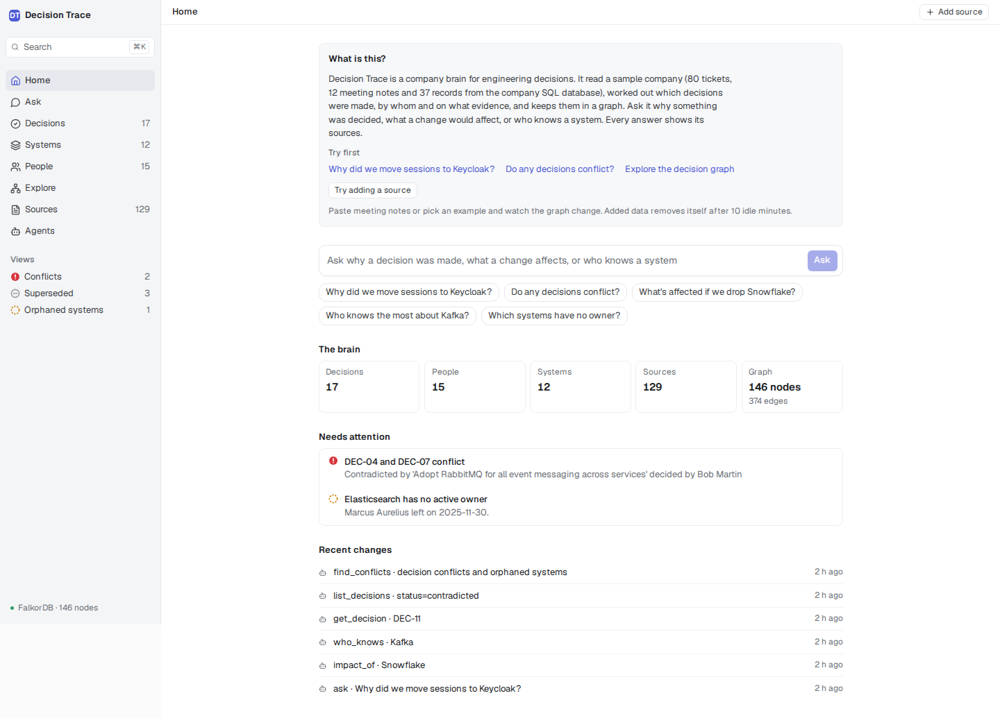
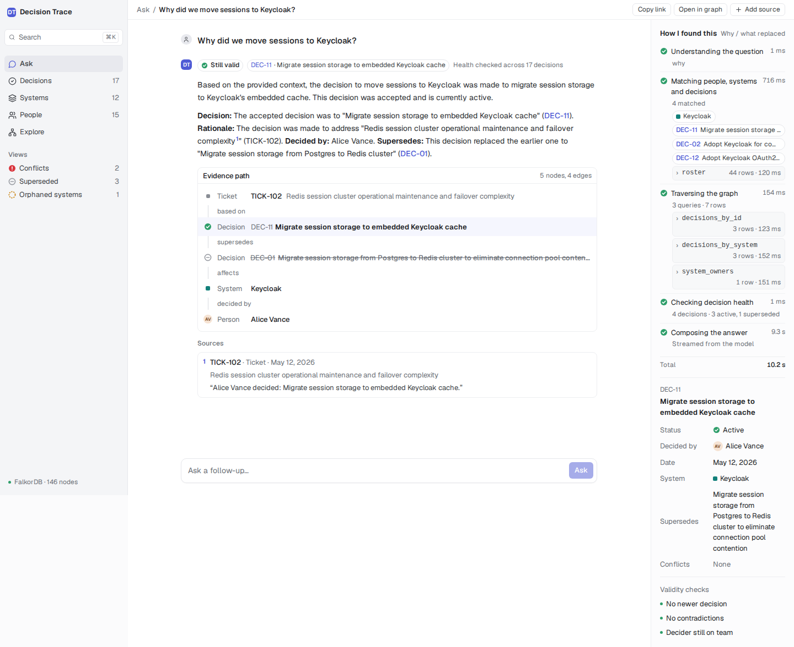
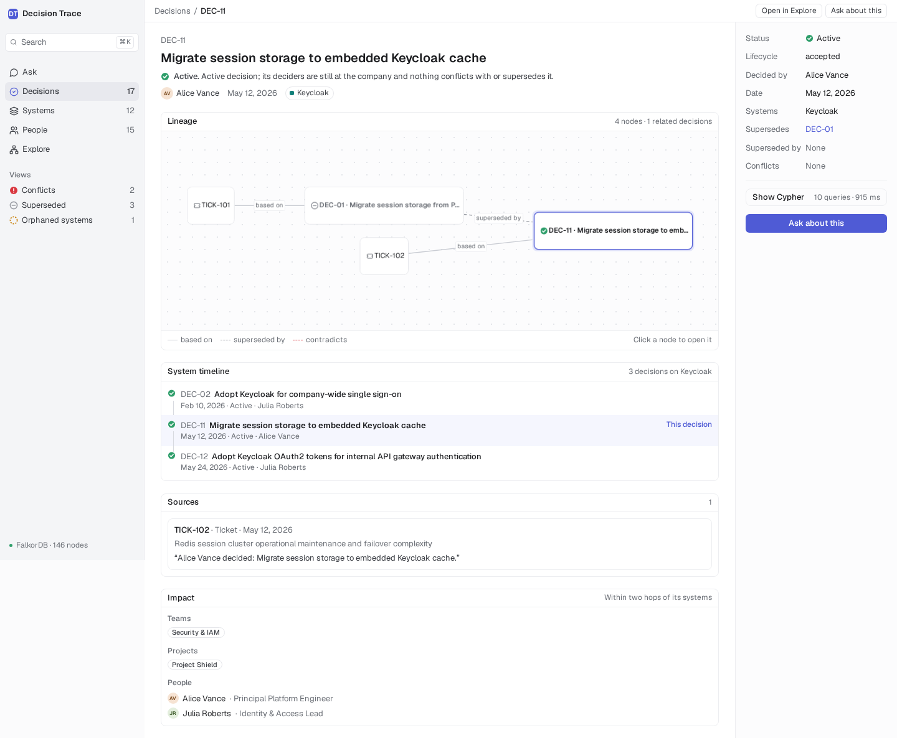
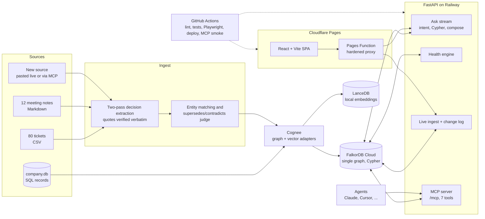

# Decision Trace

**Why did we decide that? A company brain that traces every decision to who made it, what it was based on, and whether it still holds.**

Built for the [FalkorDB Hackathon](https://www.falkordb.com/) (WeMakeDevs), Track 03: *Company Brain*, on FalkorDB Cloud and Cognee.

| | |
| :-- | :-- |
| **Landing page** | https://decision-trace.pages.dev |
| **Live app** | https://decision-trace.pages.dev/app (sample organization; create your own from the menu at the top of the sidebar) |
| **Connect an agent (MCP)** | https://decision-trace.pages.dev/app/agents · endpoint `https://decision-trace-api-production.up.railway.app/mcp` |
| **API health** | https://decision-trace-api-production.up.railway.app/health |
| **Demo video** | _link to be added_ |

<table>
  <tr>
    <td width="33%"><br><sub><b>Home</b>: what needs attention right now</sub></td>
    <td width="33%"><br><sub><b>Ask</b>: answer, evidence path, and "How I found this" with every Cypher query</sub></td>
    <td width="33%"><br><sub><b>Decision page</b>: lineage, sources with quotes, health</sub></td>
  </tr>
</table>

## Your own brain: organizations, file upload, GitHub import

- **Organizations.** Every organization is its own FalkorDB graph (`org_<id>_<random>`), created empty from the menu at the top of the sidebar. The sample organization (Acme Corp) is the original graph and stays read-only apart from its tagged demo ingests. Every endpoint, the Ask stream, the caches and the MCP tools take an organization (`/orgs/<id>/...`, or the optional `org` argument on a tool). Limits: 40-character names, 25 user organizations in total, 3 creations per hour per IP, deletion after 72 hours without activity, and a Delete option in the organization settings.
- **File upload** (Add source, any organization). `.md`, `.txt` or `.pdf`, up to 10 files, 1 MB each and 50,000 characters in total. Each file is typed (meeting, ticket, document or ADR, detected from its content unless you choose), read in chunks by the same two-pass extractor, and the result is one combined diff. Scanned PDFs are skipped with a message.
- **GitHub import** (your own organizations). Paste a public repository URL: ADR markdown from `docs/adr`, `doc/adr`, `docs/decisions`, `adr`, `architecture/decisions` or `ADR-*.md` (at most 40), plus, optionally, the last 30 closed PRs and issues that look like decisions. Status and "Supersedes ADR-n" lines become `supersedes` edges without a model call; authors become people, the repository a Project. Set `GITHUB_TOKEN` on the server for the 5,000/hour limit (without it GitHub allows 60 requests per hour and some dates are estimated, which the result says).
- **Company map.** Explore opens the whole graph: colour is node type, size is connections, Decision borders show health, tickets are hidden until you ask, search finds a node, and clicking one lights up its neighbours.

## The problem

Engineering knowledge is scattered across tickets, meeting notes and org records, and the *reasons* behind decisions are the first thing to rot. Months later someone asks:

- **Why** did we move sessions to Keycloak?
- **Who** decided it, and are they still here?
- **What** was it based on, can I read the source?
- Is it **still valid**, or was it superseded or contradicted?

Search finds documents. It does not tell you that two accepted decisions contradict each other, that the owner of a system left in November, or what breaks if you drop Snowflake. Those are questions about *relationships*, and a graph answers them directly.

## Track 03 (Company Brain) mapping

| Focus area | What delivers it |
| :-- | :-- |
| **Docs, tickets and chats in one graph** | 80 tickets, 12 meeting notes and the company SQL database (15 people, 12 systems, 4 teams, 6 projects) are loaded into **one FalkorDB graph** (146 nodes, 374 edges). The **Sources** page lists every document with the decisions it backs. Meeting notes are the conversational source; chat connectors are a next step. |
| **Who owns and who knows what** | `owns`, `member_of`, `leads` edges give ownership; **orphaned systems** flag owners who left; the `who_knows` ranking weighs decided (x3), owns (x3), meetings (x2) and tickets (x1) with the counts shown. People and Systems pages. |
| **Tracing decisions back to their source** | Every decision has `based_on` edges to the ticket or meeting it came from, each with a **verbatim quote** that is checked against the source text at extraction time. The Decision page and the Ask **evidence path** walk decision → source → people → systems. |
| **Keeping knowledge current** | **Live ingest**: paste a new note and watch two-pass extraction, entity matching and an LLM judge decide whether it supersedes, contradicts or reaffirms existing decisions. A **health engine** (superseded / contradicted / possibly stale) recomputes, and the **Needs attention** queue and change feed show what moved. |
| **Answers with sources** | `/ask` answers only from a graph subgraph computed by Cypher; citations must come from real `based_on` edges **and** be referenced in the answer. Each answer streams its steps, the Cypher it ran and its timings. The same tools are exposed to agents over **MCP**. |

## Try it in two minutes

1. **Home** → click *Why did we move sessions to Keycloak?* The answer streams in with its evidence path and sources. Open *How I found this* to see each step and Cypher query.
2. Click the **DEC-11** chip to open the **decision page**: lineage (it superseded DEC-01), the source ticket and its quote, health, deciders.
3. Open **Add source** (top right) → preset **Arch sync: standardise on Kafka** → *Run*. Watch the seven pipeline steps, then the diff: a new decision, status changes, and a resolved conflict between DEC-04 and DEC-07.
4. *Add another source* → preset **HR: Alice Vance leaves** → *Run*. Her decisions become *possibly stale* and Kafka becomes an orphaned system. *Reset demo data* puts everything back (it also resets itself after 10 idle minutes).
5. Open **Agents**, copy the endpoint into Claude Code / Claude Desktop / Cursor and ask *"Ask Decision Trace why we use Keycloak."* Every call shows up in **Recent changes** on Home.

## Architecture



- **Backend**: FastAPI (Python 3.12) with per-IP rate limits, a daily LLM token budget, bounded queries and streaming (SSE) for Ask and ingest. Deployed to Railway from a lean multi-stage Dockerfile.
- **Graph**: FalkorDB Cloud holds everything structured. Embeddings for decision-title matching live in local LanceDB (FastEmbed `bge-small-en-v1.5`), which keeps the 100 MB free tier free for the graph.
- **Frontend**: React, TypeScript, Vite, Tailwind, Cytoscape. Cloudflare Pages serves it and a Pages Function proxies `/api/*` to Railway with a path whitelist.
- **CI**: GitHub Actions lints, type-checks and unit-tests, runs about 60 Playwright tests with axe accessibility checks at 1440 and 390 px, deploys, then smoke-tests the live MCP endpoint with the official client.

## How FalkorDB is used

Everything the UI and the agents show is a Cypher query; Python only assembles rows. The Ask step list and the decision page both display the exact statements and their timings ("Show Cypher").

**Schema** (146 nodes, 374 edges)

| Nodes | Count | Relationships | Count |
| :-- | --: | :-- | --: |
| `Decision` | 17 | `assigned_to`, `raised_by`, `mentions` (Ticket → Person/System) | 80 each |
| `Person` | 15 | `attended_by` (Meeting → Person) | 38 |
| `System` | 12 | `decided_by` (Decision → Person) | 19 |
| `Team` | 4 | `based_on` (Decision → Ticket/Meeting, with a verbatim `quote`) | 18 |
| `Project` | 6 | `about_system` (Decision → System) | 18 |
| `Ticket` | 80 | `member_of`, `leads` (Person → Team/Project) | 15, 10 |
| `Meeting` | 12 | `owns` (Person → System) | 12 |
| | | `supersedes`, `contradicts` (Decision ↔ Decision) | 3, 1 |

**Real queries from the code**

*Lineage: walk the supersedes chain in both directions and find rivals* (`backend/app/brain/lineage.py`)
```cypher
MATCH (d:Decision) WHERE d.id = $id
OPTIONAL MATCH down = (d)-[:supersedes*1..5]->(older:Decision)
WITH d, collect(DISTINCT [older.id, length(down)]) AS supersedes
OPTIONAL MATCH up = (d)<-[:supersedes*1..5]-(newer:Decision)
WITH d, supersedes, collect(DISTINCT [newer.id, length(up)]) AS superseded_by
OPTIONAL MATCH (d)-[c:contradicts]-(rival:Decision)
RETURN properties(d), supersedes, superseded_by,
       collect(DISTINCT [rival.id, startNode(c).id = d.id]) AS conflicts
```

*Health: what replaced a decision, and who decided the replacement* (`backend/app/brain/health.py`)
```cypher
MATCH (d2:Decision)-[:supersedes]->(d:Decision)
OPTIONAL MATCH (d2)-[:based_on]->(t:Ticket)
OPTIONAL MATCH (d2)-[:based_on]->(m:Meeting)
RETURN d.id, d2.id, d2.title, t.ticket_id, m.title
```

*Impact: decisions on a system plus every decision in their supersedes chains* (`backend/app/askflow/queries.py`)
```cypher
MATCH (s:System)<-[:about_system]-(d:Decision) WHERE toLower(s.name) = toLower($name)
WITH collect(DISTINCT d) AS direct
UNWIND direct AS d
OPTIONAL MATCH (d)-[:supersedes*1..5]-(c:Decision)
WITH direct, collect(DISTINCT c) AS chained
UNWIND direct + chained AS x
WITH DISTINCT x
OPTIONAL MATCH (x)-[:decided_by]->(p:Person)
RETURN x.id, x.title, collect(DISTINCT p.name)
```

*Expertise: four kinds of evidence for one system, ranked in Python* (`backend/app/askflow/queries.py`)
```cypher
MATCH (s:System) WHERE toLower(s.name) = toLower($name)
OPTIONAL MATCH (s)<-[:about_system]-(d:Decision)-[:decided_by]->(p1:Person)
WITH s, collect(DISTINCT [p1.name, d.id]) AS decided
OPTIONAL MATCH (s)<-[:owns]-(p2:Person)
WITH s, decided, collect(DISTINCT p2.name) AS owns
OPTIONAL MATCH (s)<-[:about_system]-(:Decision)-[:based_on]->(:Meeting)-[:attended_by]->(p3:Person)
WITH s, decided, owns, collect(DISTINCT p3.name) AS meetings
OPTIONAL MATCH (s)<-[:mentions]-(t:Ticket)-[:raised_by|assigned_to]->(p5:Person)
RETURN decided, owns, meetings, collect(DISTINCT [p5.name, t.ticket_id])
```

*Orphaned systems: owned by someone who left* (`backend/app/brain/health.py`)
```cypher
MATCH (p:Person)-[:owns]->(s:System)
WHERE p.is_active = false
   OR (p.leave_date IS NOT NULL AND p.leave_date <> '' AND p.leave_date <= $today)
RETURN s.name, p.name, p.leave_date
```

**Why a graph.** "What is affected if we drop Snowflake?" is decisions *about* it, plus the decisions those superseded or were superseded by (variable-length paths), the people who decided them, who owns the system, which teams those people lead, and the tickets that mention it. "Do any decisions conflict?" is an edge between two accepted decisions. "Which systems have no owner?" is an `owns` edge to a person with a leave date. In SQL these are a stack of recursive joins; with vectors alone the relationship, the date and the person are lost. Here each is one readable statement that runs in about 100 to 400 ms on the free tier, and the answer can show its path.

## Evaluation

**Method.** `data/GROUND_TRUTH.md` lists the decisions, deciders, supersedes and contradicts relations in the main corpus. Two further sets of hand-written documents, `data/holdout/` (3 tickets, 3 meeting notes) and `data/holdout2/` (8 documents, 3 of them with no decision, to catch false positives), were written with their ground truth (`HOLDOUT_TRUTH.md`, `HOLDOUT2_TRUTH.md`) **before** the extractor was run on them. They avoid the "decided:" markers of the main data and bury decisions in discussion. Extraction is checked per decision against the truth by embedding similarity, and every extracted quote must appear verbatim in its source or the decision is dropped.

**Current numbers** (`bedrock/deepseek.v3.2`, temperature 0, re-run after the ticket-date fix; the graph itself did not change, 146 nodes and 374 edges):

| Set | Truth | Extracted | Recall | Precision | Decider accuracy |
| :-- | --: | --: | --: | --: | --: |
| Main corpus (`scripts/evaluate.py`, live graph) | 16 | 17 | 100% (16/16) | 94.1% | 100% |
| Holdout 1 (cold extraction) | 6 | 7 | 100% (6/6) | 85.7% | 100% |
| Holdout 2 (cold extraction, 3 negative docs) | 5 | 4 | 80% (4/5) | 100% | 100% |

Relationships on the main corpus: `supersedes` 3/3 recall and precision, `contradicts` 1/1 recall and precision. The governance check (a system owned by someone who left) finds Elasticsearch / Marcus Aurelius, who left 2025-11-30. The seven Ask benchmark questions and the five suggested questions are frozen as fixtures and re-verified live after each deploy.

For comparison, the three runs recorded before the final tuning (`data/verification_freeze_report.json`) had holdout 1 at 83 to 100% precision and recall and holdout 2 at 80 to 100%; the spread between them is the model's run-to-run variation, not an improvement or a regression.

**Honest limits.**
- The corpus is **synthetic**, generated to contain known decisions, a conflict, supersessions and a departed owner. It shows the pipeline works end to end; it does not prove accuracy on messy real company data.
- The extractor prompts were tuned on the main corpus, so the 94.1% there is optimistic. The holdouts are the fairer number, and they are small (11 truth decisions). Treat the percentages as indicative.
- Extraction is an LLM call: results vary a little between runs (see above), and the one main-corpus "false positive" is a real decision (decommissioning Snowflake) that the ground truth file does not list.
- A "why" question about something not in the graph returns *not found* rather than a guess. Questions are routed by rules plus one cheap model call for unusual phrasings; the router can still misroute a very odd question.

## Run locally

**Prerequisites:** Python 3.12, [`uv`](https://docs.astral.sh/uv/), Node.js 20+, Docker (for a local FalkorDB) and, for Ask and ingest, an LLM key (Amazon Bedrock API key, or any OpenAI-compatible endpoint such as Groq).

### Just the frontend (no backend, no keys)

The frontend ships recorded fixtures from the live API, so you can click through everything without a backend:

```bash
cd frontend
npm ci
npm run dev        # http://localhost:5173 serves the recorded data (mock mode is the default on localhost)
```

### Full stack

```bash
# 1. A local FalkorDB (a throwaway instance: step 3 deletes every graph on it)
docker run -d --name falkordb -p 6379:6379 -e REDIS_ARGS="--requirepass localpass" falkordb/falkordb

# 2. Configure
cp .env.example .env
#    Fill in:        FALKORDB_HOST=localhost   FALKORDB_PASSWORD=localpass   LLM_API_KEY=<your key>
#    Uncomment:      FALKORDB_USERNAME=default   FALKORDB_GRAPH_NAME=company_brain   DATASET_NAME=company_brain
#    Bedrock key:    also uncomment BEDROCK_API_KEY=<the same key>
#    Groq or other:  USE_GROQ=1  LLM_MODEL=groq/...  (see .env.example)
#    LLM_API_KEY must be non-empty even to just browse; Ask and ingest need a working key.

# 3. Install, then load the frozen 146-node graph (no LLM calls)
uv venv && source .venv/bin/activate
uv pip install -r backend/pyproject.toml -r backend/requirements-mcp.txt --extra dev
#    Using Amazon Bedrock as the model? also: uv pip install boto3
PYTHONPATH=backend python scripts/restore_snapshot.py restore company_brain \
    --i-know-this-deletes-all-graphs        # then type the graph name when asked

# 4. Backend  (http://localhost:8000/health, /docs)
PYTHONPATH=backend uvicorn app.main:app --port 8000

# 5. Frontend against the real backend (a second terminal)
cd frontend && npm ci
VITE_USE_MOCKS=false VITE_API_BASE_URL=http://localhost:8000 npm run dev
```

**Safety.** `scripts/seed.py` (re-runs the whole LLM pipeline) and `scripts/restore_snapshot.py restore` delete *every* graph on the FalkorDB instance. They refuse to run without `--i-know-this-deletes-all-graphs` and the graph name typed back, and refuse the production graph unless `--force-production` is also given. Never point them at a shared instance.

**Tests and checks**

```bash
PYTHONPATH=backend pytest backend/tests -m "not integration"     # 140+ backend tests, no network
ruff check backend
cd frontend && npx vitest run && npx eslint . && npx tsc --noEmit  # 150+ unit tests, lint, types
cd frontend && npm run build && npx playwright install chromium && npx playwright test   # 60 e2e tests with axe
PYTHONPATH=backend python scripts/evaluate.py                    # score the loaded graph (read-only)
```

Other scripts: `scripts/load_test.py` and `scripts/live_walkthrough.mjs` (production load test and a fresh-browser walkthrough), `scripts/mcp_smoke.py [URL]` (calls every MCP read tool), `scripts/evaluate_holdout.py` / `evaluate_holdout2.py` (cold extraction on their own dataset; delete the graph they leave behind).

All environment variables are documented in [`.env.example`](.env.example) and [`frontend/.env.example`](frontend/.env.example).

## Connect an agent (MCP)

Endpoint (Streamable HTTP, no sign-in, 20 calls a minute per IP): `https://decision-trace-api-production.up.railway.app/mcp`

Tools: `ask`, `get_decision`, `list_decisions`, `impact_of`, `who_knows`, `find_conflicts` (all read-only) and `add_source` (writes demo data that removes itself after 10 idle minutes; disable with `MCP_READ_ONLY=true`).

**Claude Desktop and claude.ai (recommended):** Settings → Connectors → *Add custom connector* → paste the endpoint URL.

**Claude Code**
```bash
claude mcp add --transport http decision-trace https://decision-trace-api-production.up.railway.app/mcp
```

**Claude Desktop, config-file alternative** (`claude_desktop_config.json`, needs Node.js 18+)
```json
{
  "mcpServers": {
    "decision-trace": {
      "command": "npx",
      "args": ["-y", "mcp-remote", "https://decision-trace-api-production.up.railway.app/mcp", "--transport", "http-only"]
    }
  }
}
```

**Cursor** (`.cursor/mcp.json` or `~/.cursor/mcp.json`)
```json
{
  "mcpServers": {
    "decision-trace": { "url": "https://decision-trace-api-production.up.railway.app/mcp" }
  }
}
```

Formats checked against the [Claude Code](https://code.claude.com/docs/en/mcp), [MCP](https://modelcontextprotocol.io/docs/develop/connect-remote-servers) and [Cursor](https://cursor.com/docs/context/mcp) docs and the [mcp-remote](https://github.com/geelen/mcp-remote) README. Try: *"Use Decision Trace to tell me what is affected if we drop Snowflake."*

## Built during the hackathon, and how

The commit history is the timeline (84 commits, all public):

| Dates | What was built |
| :-- | :-- |
| **Oct 11** | Repository scaffold: configuration, FalkorDB adapter, Cognee memory wiring, health endpoint, Dockerfile, first tests. |
| **Oct 14** | Graph model, decision identity reconciliation, the synthetic company dataset with ground truth, SQL/ticket/meeting ingestion, the seed pipeline and the first evaluation. |
| **Oct 15 to 16** | Two-pass extraction with verified quotes, the decision health engine, citation integrity, deployment (Railway, Cloudflare Pages, CI), the Linear-style UI, decision pages, Systems and People, live ingest with the change diff. |
| **Oct 17 to 18** | Streamed Ask with impact, expertise and status intents, Sources, demo safety, the MCP server, Home and Agents pages, hardening (timeouts, token budget, error states), this README. |

**How coding assistants were used, honestly:** an AI coding agent (Claude Code) wrote most of the code under my direction, and I used Claude for design discussions, prompt design and review. I made the product and architecture decisions (what the graph models, the health rules, the evaluation method, what to cut), set the acceptance criteria phase by phase, and verified the results: running the evaluation, checking live answers against the ground truth, reviewing screenshots, and testing the deployed app. The `docs/AGENT_HANDOFF.md` file is the running context document the agent worked from.

## Limits and next steps

- **Synthetic, single-tenant data.** One company, one graph, no per-user access control; the public demo has no sign-in and relies on rate limits, a daily token budget and automatic reset of demo ingests.
- **Sources.** Tickets (CSV), Markdown meeting notes and a SQL database. Next: Slack, Jira, GitHub and Confluence connectors so decisions are captured where they happen.
- **Auth and permissions.** Decisions inherit the visibility of their sources; that needs real identity and per-source ACLs.
- **Scale.** The free FalkorDB tier and a single backend instance are fine for a demo; larger graphs need incremental ingest and cached health.
- **Extraction quality.** An LLM judges supersedes and contradicts; a review queue for low-confidence links would make that safe for real use.

## Credits

- **[FalkorDB](https://www.falkordb.com/)**: the graph database powering every query ([GitHub](https://github.com/FalkorDB/FalkorDB)).
- **[Cognee](https://www.cognee.ai/)**: memory and knowledge-graph orchestration ([GitHub](https://github.com/topoteretes/cognee), Apache-2.0) with the [FalkorDB community adapter](https://pypi.org/project/cognee-community-hybrid-adapter-falkor/).
- **[WeMakeDevs](https://www.wemakedevs.org/)**: for running the hackathon.
- [FastEmbed](https://github.com/qdrant/fastembed), [LanceDB](https://github.com/lancedb/lancedb), [FastAPI](https://fastapi.tiangolo.com/), [Cytoscape.js](https://js.cytoscape.org/), [MCP Python SDK](https://github.com/modelcontextprotocol/python-sdk).

Licensed under the [MIT License](LICENSE).
